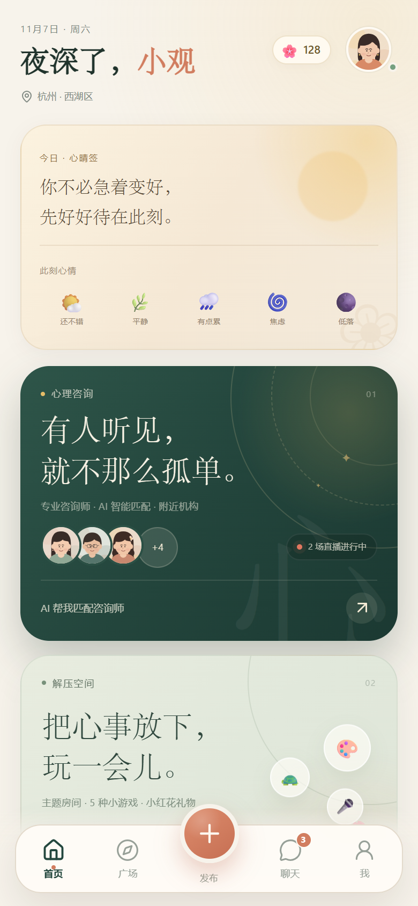
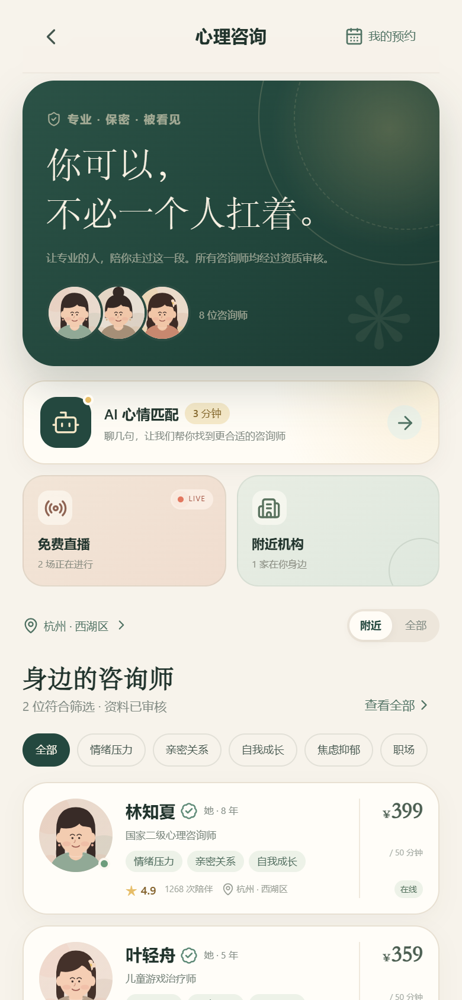
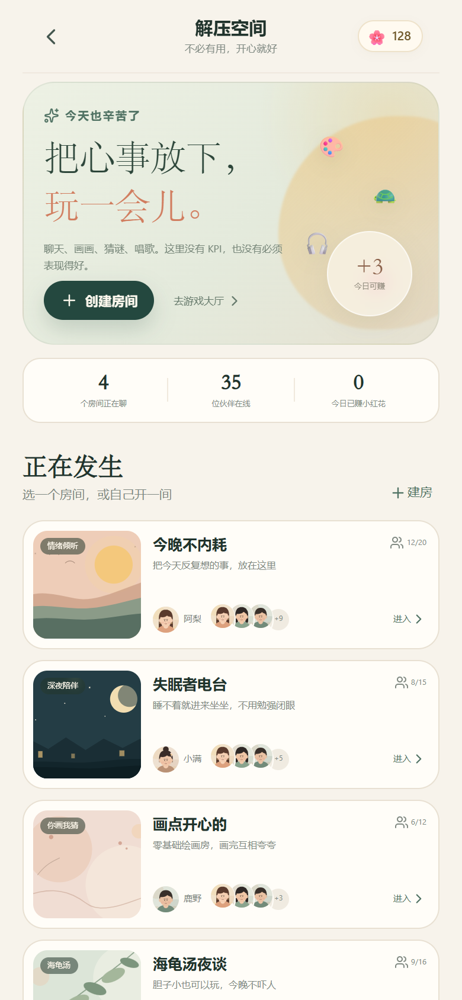
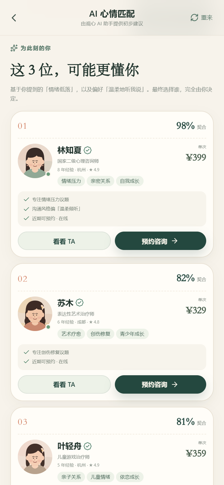
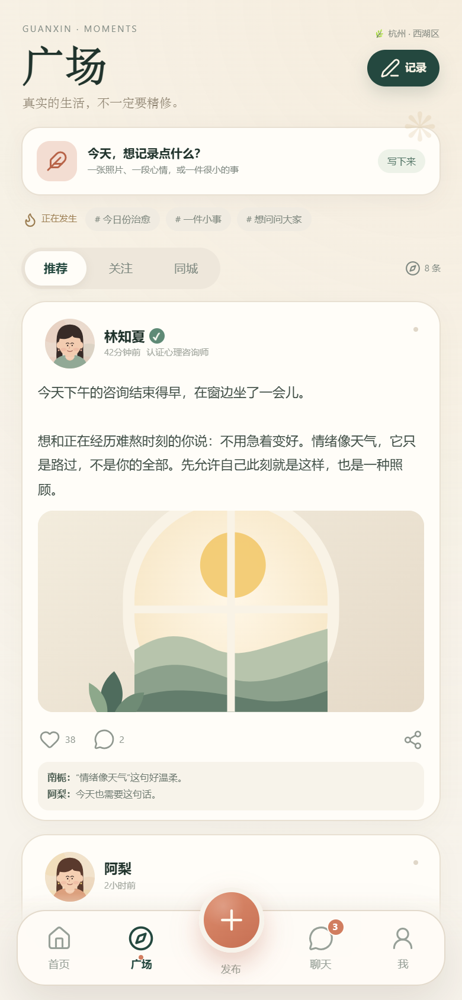
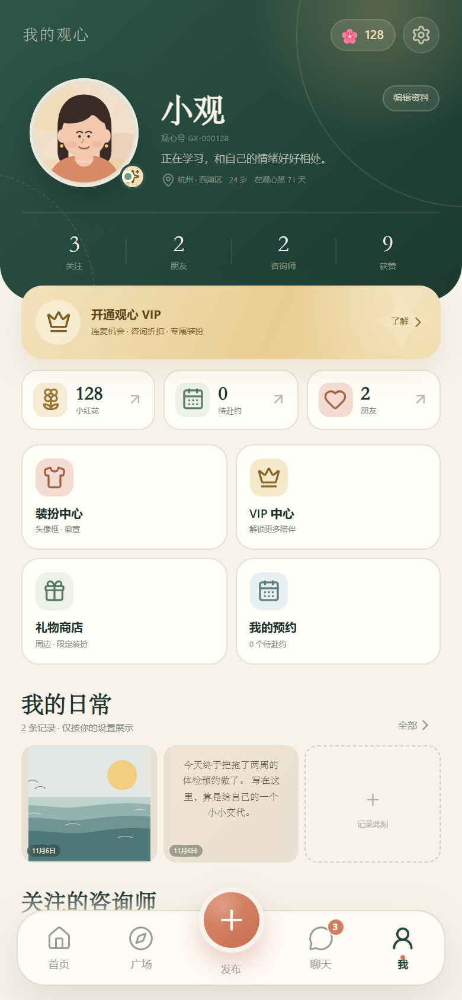

# 观心 · My_Heart

> 看见情绪，也看见自己。

观心是一款面向用户的移动端心理陪伴应用原型，包含心理咨询、AI 心情匹配、免费直播、解压空间、小红花礼物、广场与聊天等完整用户端体验。项目使用 React + TypeScript + Vite 构建，数据和演示人物均保存在浏览器本地，打开即可体验，无需后端或手机验证码。

## 界面预览

| 首页 | 心理咨询 | 解压空间 |
| --- | --- | --- |
|  |  |  |

| AI 心情匹配 | 广场 | 我的 |
| --- | --- | --- |
|  |  |  |

桌面预览：[preview/10-desktop.png](preview/10-desktop.png)

---

## 快速开始

```bash
cd D:\MySoft\My_Heart
npm install
npm run dev
```

浏览器打开：<http://localhost:5178>

生产构建：

```bash
npm run build
npm run preview
```

建议使用手机尺寸预览（390 × 844）。桌面打开时会显示手机外框和品牌介绍页。

### 演示账号

| 账号 | 密码 | 说明 |
| --- | --- | --- |
| `13800000000` | `123456` | 已完善资料、拥有示例好友/咨询师/日常的体验账号 |

也可以点击登录页的「一键体验 · 使用示例账号」，或直接注册一个新账号（无需验证码），完成年龄、性别、地区三步引导即可进入。

---

## 已实现功能

### 1. 注册 / 登录 / 个人资料
- 手机号 + 密码注册，不需要手机验证码。
- 登录、密码显隐、错误提示、一键体验账号。
- 注册后三步资料引导：年龄、性别、所在地区。
- 支持修改昵称、年龄、性别、地区、简介和头像。
- 密码与资料仅保存在本机 `localStorage`。

### 2. 地区与本地资源
- 选择省 / 市 / 区三级地区。
- 「心理咨询」模块默认展示用户所在城市的咨询师与线下机构，也可以切换到全部地区。
- 更换地区后，推荐会同步更新。

### 3. AI 心情匹配
- 五轮对话式提问：困扰方向、持续时间、陪伴偏好、预算、咨询方式。
- 根据困扰、沟通风格、预算、地区、年限进行本地规则匹配。
- 展示 3 位推荐咨询师、匹配度与推荐理由。
- 用户可自由查看主页、预约、重新匹配，AI 不替用户做选择。

### 4. 心理咨询师与机构
- 8 位示例咨询师：资质、年限、擅长方向、价格、评价、咨询方式。
- 6 家示例咨询机构：地址、营业时间、联系电话、空间插画、所属咨询师。
- 咨询师详情页可关注、聊天、查看机构、预约。

### 5. 预约咨询与 VIP 折扣
- 未来 7 天日期 + 时段选择。
- 支持视频 / 语音 / 面对面（以咨询师实际支持的方式为准）。
- VIP 自动折扣：周卡 95 折、月卡 9 折、年卡 85 折。
- 年卡赠送 1 次 60 分钟面对面权益，可在预约时抵扣。
- 我的预约支持待咨询、已完成、已取消，以及取消预约。

### 6. 免费直播
- 直播列表、直播预告、免费标签，包含心理知识、正念练习、亲密关系与读书会主题。
- 直播间：咨询师信息、文字互动、送心、申请连麦。
- 普通用户连麦会引导开通 VIP；周卡 2 次，月卡 / 年卡不限次。
- 未开播的直播支持预约提醒。

### 7. 解压空间
- 4 个示例主题房间，可进入聊天、查看成员、在房内发起小游戏。
- 支持创建自己的房间，创建即得 1 朵小红花。
- 房间内聊天会得到示例伙伴的本地模拟回应。

### 8. 五种小游戏
| 游戏 | 玩法 | 奖励 |
| --- | --- | --- |
| 你画我猜 | Canvas 手绘，提交后房间伙伴猜画 | +3 🌸 |
| 海龟汤 | 提问、揭晓汤底 | +2 🌸 |
| 猜成语 | 5 道看图猜成语 | +2 🌸 |
| 听歌识曲 | Web Audio 合成旋律，4 选 1 | +2 🌸 |
| K 歌房 | 歌词跟唱、点亮能量、结束评分 | +3 🌸 |

完成游戏即时获得小红花并弹出奖励卡片。

### 9. 小红花与礼物
- 小红花作为虚拟积分，可在商店兑换：
  - 虚拟装扮：头像框、徽章。
  - 实体周边：观心随行杯、种子卡、帆布袋、香薰。
- 实体礼物为演示商品，兑换后不会真实发货。
- 装扮中心支持头像框、徽章、头像切换；VIP 专属装扮在会员期内解锁。

### 10. 广场
- 微信朋友圈式日常流：推荐 / 关注 / 同城。
- 发布文字、图片（本地压缩上传，最多 3 张）或视频链接。
- 可以选用观心内置心情插画作为配图。
- 四种可见范围：公开、朋友可见、部分人可见（指定好友）、仅自己可见。
- 点赞、评论、复制分享、删除自己的日常。

### 11. 聊天
- 与咨询师、朋友、观心小助手聊天。
- 消息未读角标、在线状态、快捷回复、发送后本地模拟回复。
- 可从咨询师详情、聊天列表或新增聊天面板发起会话。

### 12. 个人主页
- 头像、昵称、观心号、简介、地区、年龄、加入天数。
- 关注 / 朋友 / 咨询师 / 获赞统计和关系列表。
- 我的日常、我的预约、装扮中心、VIP 中心、小红花商店。
- 设置：通知开关、版本信息、重置演示数据、退出登录。

---

## 视觉与交互

- 移动优先，390px 宽度下精细适配；桌面端呈现为居中的手机外框。
- 主色：墨绿 `#24483F`、陶土橙 `#D17D5F`、奶油纸色 `#F7F3EB`、金色 `#E6BD68`。
- 标题使用宋体风格字体，正文使用系统中文无衬线字体。
- 所有头像、插画、机构空间图均为本地 SVG 绘制，不依赖外部图片 CDN。
- 支持触控绘制、页面过渡、弹层、奖励动效等移动端交互。

---

## 目录结构

```text
My_Heart/
├─ public/
│  ├─ favicon.svg
│  └─ manifest.webmanifest
├─ src/
│  ├─ components/        # 通用 UI、头像、插画、导航、卡片
│  ├─ screens/           # 各业务页面
│  │  └─ games/          # 五种小游戏
│  ├─ styles/            # 设计系统与页面样式
│  ├─ App.tsx            # 路由与页面壳
│  ├─ data.ts            # 示例咨询师、机构、动态、房间、对话
│  ├─ store.tsx          # 全局状态、登录、业务动作、localStorage
│  ├─ navigation.tsx     # 页面栈导航
│  ├─ theme.ts           # 地区、装扮、VIP、商店、游戏配置
│  ├─ types.ts
│  ├─ utils.ts
│  └─ audio.ts           # Web Audio 旋律合成
├─ index.html
├─ package.json
└─ vite.config.ts
```

---

## 测试阶段说明

这是用户端前端原型，以下能力为演示实现：

- **AI 匹配**：当前使用本地可解释规则，不调用外部大模型；后续可替换为真实 AI 服务。
- **直播**：直播间为演示场景，未接入真实音视频推流。
- **聊天 / 房间**：没有实时服务端，伙伴回复由本地示例数据模拟。
- **支付**：VIP 开通为模拟支付，不会产生真实扣款。
- **实体礼物**：不会真实发货，仅记录兑换结果。
- **账号安全**：数据仅保存在浏览器本地，密码未接入服务端加密体系，请勿用于生产环境。

咨询师专用端将在后续版本加入。当前咨询师均为示例人物，可继续扩展真实咨询师入驻、排班、接单与直播推流能力。

> 观心提供心理支持与陪伴，不替代医疗诊断与治疗。若处于紧急危机中，请优先联系当地急救或心理援助热线。
