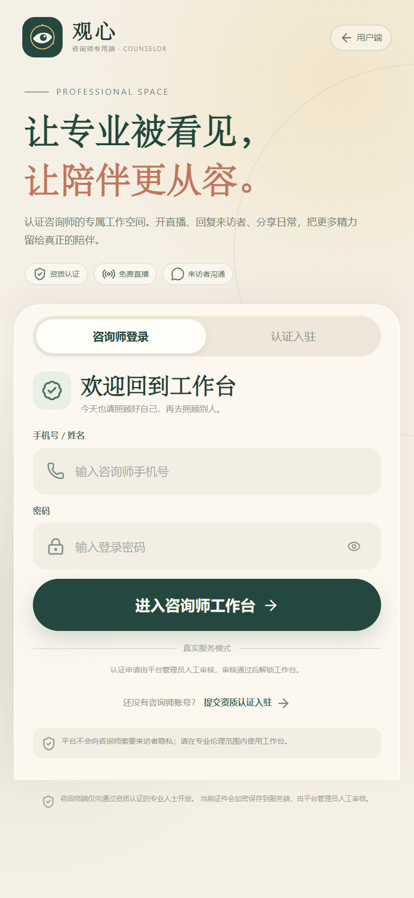
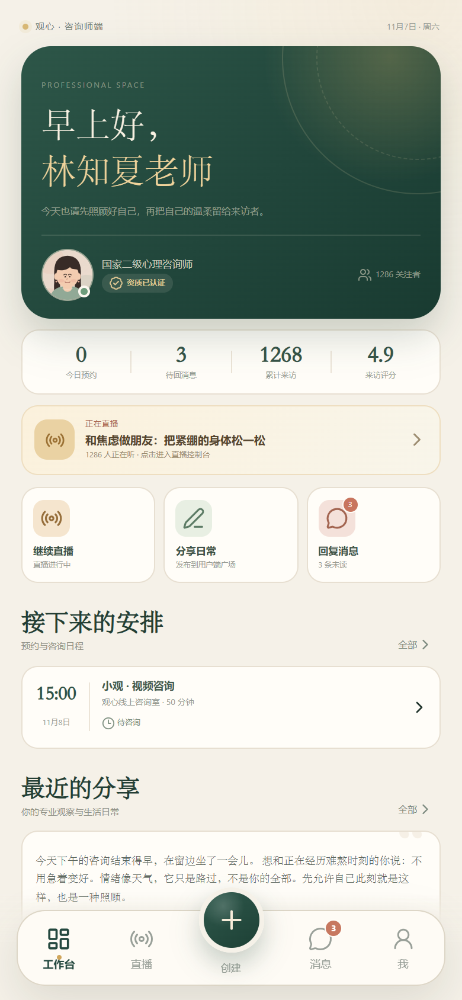
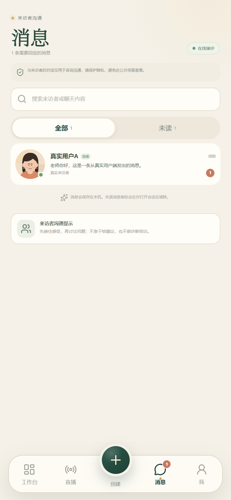
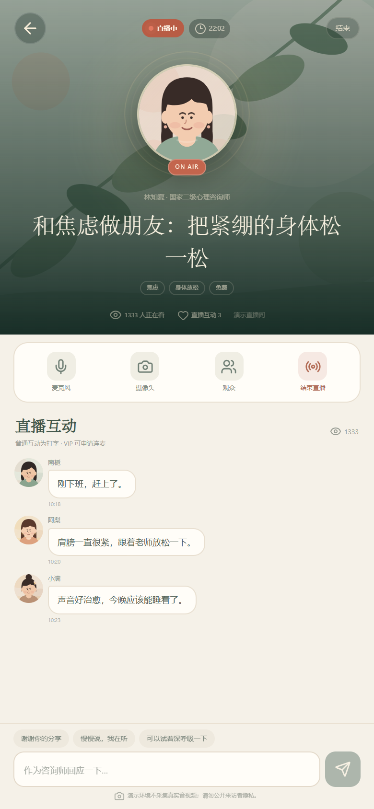
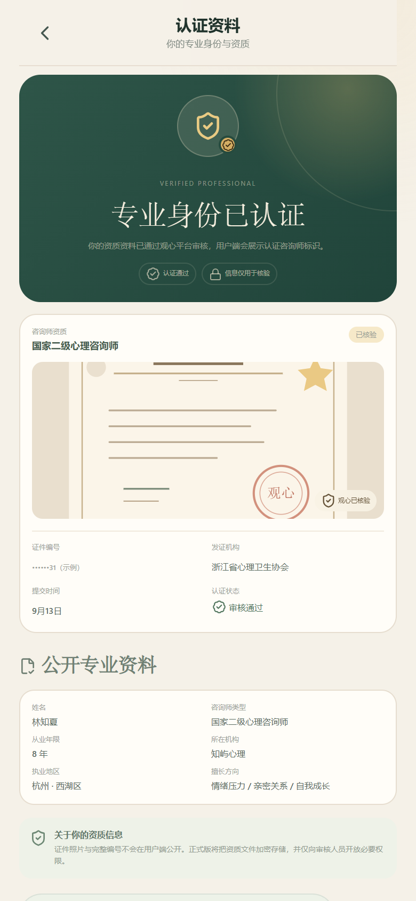
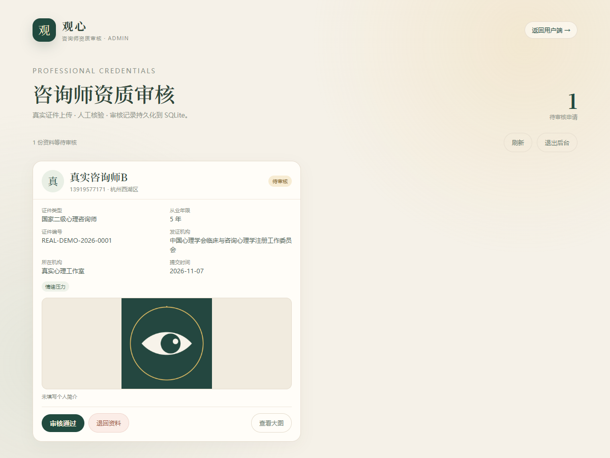

# 观心 · My_Heart

> 看见情绪，也看见自己。

观心是一款移动端心理陪伴应用，包含用户端与咨询师专用端。用户端提供心理咨询、AI 心情匹配、免费直播、解压空间、小红花礼物、广场与聊天等体验；咨询师端提供资质认证、工作台、免费直播、来访者沟通与专业日常分享。

前端使用 React + TypeScript + Vite；本次已加入真实的 Node.js + SQLite 后端基础：bcrypt 密码哈希、JWT HTTP-only 会话、服务端数据共享、WebSocket 实时聊天、咨询师证件文件上传、人工审核后台和审核记录持久化。

> 当前仓库包含两套运行方式：**连接真实后端**（推荐，需本地启动或部署服务端）与**静态前端回退模式**（GitHub Pages/APK 在无法连接 `/api` 时使用本地存储）。以下会明确区分仍然依赖第三方的功能。

## 在线体验

用户端：https://kormar-zane.github.io/My_Heart/

咨询师专用端：https://kormar-zane.github.io/My_Heart/#counselor

代码仓库：https://github.com/Kormar-Zane/My_Heart

> GitHub Pages 只能托管静态前端，因此线上地址默认运行在本地回退模式。真实后端需要 Node 运行环境，当前请按下方“快速开始（真实后端）”在本地启动；部署到云服务器后，前端才会在线上连接真实数据库。

## Android 安装包

测试版 APK 通过 GitHub Releases 发布：

https://github.com/Kormar-Zane/My_Heart/releases/latest

- 适用于 Android 7.0 及以上
- 从 `v1.1.0` 起，同一个安装包内包含用户端与咨询师专用端：登录页底部可进入咨询师端，用户登录后也可从「我 → 设置 → 咨询师专用端」进入
- 下载 APK 后，在手机文件管理器中打开，按提示允许“安装未知应用”
- 当前为测试签名版本，适合内测体验；正式上架应用商店需要单独配置发布签名和隐私合规材料
- **注意**：现有 APK 是静态打包版本，尚未配置云端 API 地址，无法直接连接本地后端；需要先部署服务端并设置 `VITE_API_BASE`/同域反代，再重新打包 APK

## 界面预览

> 以下截图来自本地真实后端联调环境，人物与证件内容为测试数据。

| 首页 | 心理咨询 | 解压空间 |
| --- | --- | --- |
|  |  |  |

| AI 心情匹配 | 广场 | 我的 |
| --- | --- | --- |
|  |  |  |

桌面预览：[preview/10-desktop.png](preview/10-desktop.png)

### 咨询师专用端

| 认证登录 | 工作台 | 来访者消息 |
| --- | --- | --- |
|  |  |  |

| 直播控制台 | 认证资料 | 资质审核后台 |
| --- | --- | --- |
|  |  |  |

---

## 快速开始（真实后端）

要求：Node.js 24+、npm。

```powershell
cd D:\MySoft\My_Heart
Copy-Item .env.example .env
# 编辑 .env：至少修改 JWT_SECRET 和 ADMIN_PASSWORD
npm install
npm run dev:full
```

启动后：

| 服务 | 地址 |
| --- | --- |
| 用户端 / 咨询师端（Vite） | <http://localhost:5178> |
| API 服务 | <http://localhost:8787/api> |
| 咨询师资质审核后台 | <http://localhost:8787/admin> |

`dev:full` 会同时启动 Vite 和 Node 后端。也可以分别运行：

```powershell
npm run server   # 只启动 API + 管理后台
npm run dev      # 只启动前端（需另开终端）
```

### 首次使用流程

1. 在用户端注册一个真实用户账号（无需验证码），完成年龄、性别、地区引导。
2. 进入「咨询师专用端 → 认证入驻」，填写资质、上传证件照片并提交。
3. 打开 <http://localhost:8787/admin>，使用 `.env` 中的 `ADMIN_PASSWORD` 登录，审核证件并通过。
4. 回到咨询师端点击「刷新审核状态」，解锁工作台。
5. 用户端打开该咨询师主页 →「聊一聊」发起会话；咨询师端「消息」会实时收到，双方可双向回复。
6. 用户预约咨询后，预约会出现在咨询师端的「咨询日程」。

> 默认 `JWT_SECRET`/`ADMIN_PASSWORD` 仅用于本地开发，启动日志会给出警告。生产环境必须修改，并建议使用 HTTPS、对象存储、备份和审计日志。

### 环境变量

```ini
PORT=8787
DATABASE_PATH=server/data/guanxin.db
JWT_SECRET=replace-with-a-long-random-secret
ADMIN_PASSWORD=replace-with-a-strong-admin-password
COOKIE_SECURE=false

AI_BASE_URL=https://api.deepseek.com
AI_API_KEY=
AI_MODEL=deepseek-chat
```

- SQLite 数据库：`server/data/guanxin.db`（已加入 `.gitignore`）
- 证件文件：`server/uploads/credentials/`（已加入 `.gitignore`）
- 管理员密码只在服务端 `.env` 中读取，不会进入前端包。
- 首次启动会把 `server/seed-data.json` 中的咨询师、机构、动态、直播内容写入数据库；**不会创建演示用户**。
- 种子咨询师是初始内容档案，未绑定登录账号；真实咨询师必须走「认证入驻 → 管理员审核」流程后才能登录工作台。
- 配置 `AI_API_KEY` 后，AI 心情匹配会调用服务端 `/api/ai/match`，由 DeepSeek 等 OpenAI 兼容模型生成真实推荐；未配置或调用失败时回退本地规则，界面会明确标注「本地规则匹配」。

### 静态前端 / 本地回退

```powershell
npm run dev      # 未启动后端时，会显示「本地模式」
npm run build
npm run preview
```

无法连接 `/api` 时，前端使用 `localStorage` 回退，方便预览 UI；此时账号、聊天、认证审核都不会跨设备同步。GitHub Pages 与未重新配置 API 的 APK 都运行在这一模式。

### 生产构建

```powershell
npm run build
npm start
```

后端会从 `dist/` 提供前端页面，并在同一域名提供 `/api` 和 `/ws`，访问 <http://localhost:8787>。部署到云服务器时需配置 HTTPS、反向代理、数据盘持久化和备份。

---

## 已实现功能

### 1. 注册 / 登录 / 个人资料
- 手机号 + 密码注册，不需要手机验证码。
- 真实后端：`bcrypt` 密码哈希、JWT HTTP-only Cookie 会话、服务端用户表。
- 登录、注册、密码显隐、错误提示；已移除「一键体验」示例登录。
- 注册后三步资料引导：年龄、性别、所在地区。
- 支持修改昵称、年龄、性别、地区、简介和头像，修改会写回服务端。
- 未连接后端时回退到本地模式；两种模式的界面状态会明确标注。

### 2. 地区与本地资源
- 选择省 / 市 / 区三级地区。
- 「心理咨询」模块默认展示用户所在城市的咨询师与线下机构，也可以切换到全部地区。
- 更换地区后，推荐会同步更新。

### 3. AI 心情匹配
- 五轮对话式提问：困扰方向、持续时间、陪伴偏好、预算、咨询方式。
- 配置 `AI_API_KEY` 后，服务端把用户回答、城市与咨询师公开资料发送给大模型，由模型返回 3 位推荐、契合度与个性化理由；结果会标注「AI 实时分析」。
- 发送内容不包含手机号、密码或聊天记录；密钥只保存在服务端 `.env`，不会进入前端包。
- 未配置密钥或模型调用失败时，自动回退到本地规则匹配，不影响预约流程。
- 展示 3 位推荐咨询师、匹配度与推荐理由。
- 用户可自由查看主页、预约、重新匹配，AI 不替用户做选择。

### 4. 心理咨询师与机构
- 8 位初始咨询师档案：资质、年限、擅长方向、价格、评价、咨询方式；通过人工认证的新咨询师会写入同一张表并进入用户端展示。
- 6 家初始咨询机构：地址、营业时间、联系电话、空间插画、所属咨询师。
- 咨询师详情页可关注、聊天、查看机构、预约；关注与预约会写入服务端。

### 5. 预约咨询与 VIP 折扣
- 未来 7 天日期 + 时段选择。
- 支持视频 / 语音 / 面对面（以咨询师实际支持的方式为准）。
- VIP 自动折扣：周卡 95 折、月卡 9 折、年卡 85 折。
- 年卡赠送 1 次 60 分钟面对面权益，可在预约时抵扣。
- 预约写入 SQLite；用户端创建后，咨询师端「咨询日程」会立即看到来访者姓名、时间与方式。
- 我的预约支持待咨询、已完成、已取消，以及取消预约。
- 价格折扣与年卡权益在服务端重新计算，避免只信任前端价格。

### 6. 免费直播（仍为演示）
- 直播列表、直播预告、免费标签，包含心理知识、正念练习、亲密关系与读书会主题。
- 直播间：咨询师信息、文字互动、送心、申请连麦；未接入真实音视频推流。
- 普通用户连麦会引导开通 VIP；周卡 2 次，月卡 / 年卡不限次。
- 未开播的直播支持预约提醒。

### 7. 解压空间（仍为本地）
- 4 个示例主题房间，可进入聊天、查看成员、在房内发起小游戏。
- 支持创建自己的房间，创建即得 1 朵小红花。
- 房间内聊天会得到示例伙伴的本地模拟回应。

### 8. 五种小游戏
| 游戏 | 玩法 | 奖励 |
| --- | --- | --- |
| 你画我猜 | Canvas 手绘，提交后房间伙伴猜画 | +3 🌸 |
| 海龟汤 | 提问、揭晓汤底 | +2 🌸 |
| 猜成语 | 5 道看图猜成语 | +2 🌸 |
| 听歌识曲 | Web Audio 合成旋律，4 选 1 | +2 🌸 |
| K 歌房 | 歌词跟唱、点亮能量、结束评分 | +3 🌸 |

完成游戏即时获得小红花并弹出奖励卡片。

### 9. 小红花与礼物（仍为演示）
- 小红花作为虚拟积分，可在商店兑换：
  - 虚拟装扮：头像框、徽章。
  - 实体周边：观心随行杯、种子卡、帆布袋、香薰。
- 实体礼物为演示商品，兑换后不会真实发货。
- 装扮中心支持头像框、徽章、头像切换；VIP 专属装扮在会员期内解锁。

### 10. 广场
- 微信朋友圈式日常流：推荐 / 关注 / 同城。
- 发布文字、图片（浏览器压缩，最多 3 张）或视频链接。
- 可以选用观心内置心情插画作为配图。
- 四种可见范围：公开、朋友可见、部分人可见（指定好友）、仅自己可见。
- 点赞、评论、删除自己的日常；真实模式下写入服务端并通过 WebSocket 广播新内容。
- 目前图片以压缩后的 data URL 存入 SQLite，生产环境应改为对象存储。

### 11. 聊天
- 与咨询师、朋友、观心小助手聊天。
- 用户 ↔ 咨询师的会话、消息与已读状态写入 SQLite；WebSocket 实时推送到双方页面。
- 两个浏览器/两台同一局域网设备分别登录用户和咨询师后，可以真实双向聊天。
- 消息未读角标、在线状态、快捷回复；真实模式不再自动生成假回复。
- 朋友聊天、观心小助手仍为本地回退能力，尚未接入独立好友/客服服务。
- 可从咨询师详情、聊天列表或新增聊天面板发起会话。

### 12. 个人主页
- 头像、昵称、观心号、简介、地区、年龄、加入天数。
- 关注 / 朋友 / 咨询师 / 获赞统计和关系列表。
- 我的日常、我的预约、装扮中心、VIP 中心、小红花商店。
- 设置：通知开关、版本信息、本地缓存清理、退出登录，以及真实后端/本地模式状态。

### 13. 咨询师专用端
- 独立入口与独立工作台导航：工作台 / 直播 / 创建 / 消息 / 我。
- 咨询师登录，以及「认证入驻」三步流程：
  - 账号信息：姓名、手机号、密码、性别。
  - 专业资质：证件类型、证件编号、发证机构、从业年限、机构、执业地区、擅长方向。
  - 上传咨询师证件照片、个人简介、真实性承诺。
- 证件照片通过 `multipart/form-data` 上传到服务端，保存到 `server/uploads/credentials/`；账号状态与证件记录写入 SQLite。
- 未认证账号只能看到「审核中」页，不能使用直播、聊天、发布功能。
- 平台管理员打开 <http://localhost:8787/admin>，使用 `ADMIN_PASSWORD` 登录，可查看证件大图、审核通过或退回并记录原因。
- 审核通过后创建公开咨询师档案并解锁工作台；审核结果不会由前端自助通过。
- 工作台：今日预约、未读消息、累计来访、评分、直播状态、咨询日程、最近日常。
- 直播：选择主题、标题、简介与封面后开播；直播控制台支持计时、观看人数、观众互动、快捷回复和结束小结。开播后用户端「免费直播」会同步出现该直播间。**真实音视频推流仍未接入。**
- 聊天：来访者会话列表、未读筛选、搜索、来访者档案、快捷回复；真实模式下来自用户的消息会通过 WebSocket 即时出现。
- 分享日常：文字 + 最多 3 张图片或观心插画，发布后出现在用户端广场并写入数据库。
- 个人中心：认证信息、证件脱敏编号、公开专业资料、咨询日程、日常列表、切换用户端和退出登录。

---

## 视觉与交互

- 移动优先，390px 宽度下精细适配；桌面端呈现为居中的手机外框。
- 主色：墨绿 `#24483F`、陶土橙 `#D17D5F`、奶油纸色 `#F7F3EB`、金色 `#E6BD68`。
- 标题使用宋体风格字体，正文使用系统中文无衬线字体。
- 所有头像、插画、机构空间图均为本地 SVG 绘制，不依赖外部图片 CDN。
- 支持触控绘制、页面过渡、弹层、奖励动效等移动端交互。

---

## 目录结构

```text
My_Heart/
├─ server/
│  ├─ index.mjs           # Express API、JWT、WebSocket、上传、管理后台
│  ├─ db.mjs              # node:sqlite 表结构、种子数据、密码哈希
│  ├─ admin.html          # 咨询师资质审核后台
│  ├─ seed-data.json      # 初始咨询师/机构/动态/直播内容
│  └─ data/               # SQLite 数据库（gitignored）
├─ scripts/
│  └─ export-seed.mjs     # 从前端种子导出服务端 seed JSON
├─ public/
│  ├─ favicon.svg
│  └─ manifest.webmanifest
├─ src/
│  ├─ components/         # 通用 UI、头像、插画、导航、卡片
│  ├─ counselor/          # 咨询师认证、工作台、直播、聊天、日常
│  ├─ screens/            # 用户端各业务页面
│  │  └─ games/           # 五种小游戏
│  ├─ styles/             # 设计系统与页面样式（含 counselor.css）
│  ├─ api.ts              # 前端 API / 上传 / 会话请求封装
│  ├─ App.tsx             # 路由、用户端/咨询师端模式
│  ├─ data.ts             # 本地回退种子与初始内容
│  ├─ store.tsx           # 状态、真实 API 同步、WebSocket、localStorage 回退
│  ├─ navigation.tsx      # 页面栈导航
│  ├─ theme.ts            # 地区、装扮、VIP、商店、游戏配置
│  ├─ types.ts
│  ├─ utils.ts
│  └─ audio.ts            # Web Audio 旋律合成
├─ .env.example
├─ index.html
├─ package.json
└─ vite.config.ts
```

---

## 真实实现与剩余边界

### 已改为真实后端

- 用户注册/登录、bcrypt 密码哈希、JWT HTTP-only 会话。
- 用户资料、关注、动态、点赞、评论、预约写入 SQLite。
- 用户 ↔ 咨询师的会话、消息、已读状态与 WebSocket 实时推送。
- 咨询师账号、证件 `multipart` 上传、审核状态与审核记录。
- 管理员后台登录、查看证件、通过/退回、审核落库。
- 审核通过后创建公开咨询师档案，用户端可见并可预约/聊天。
- **AI 心情匹配**：配置 `AI_API_KEY` 后由服务端调用 DeepSeek 兼容接口，返回真实模型推荐；密钥只存在服务端。

### 仍为本地或第三方待接入

- **AI 匹配（无密钥时）**：未配置 `AI_API_KEY` 或上游失败时使用本地规则，并在结果页标注「本地规则匹配」。
- **直播**：房间与文字互动可用，但未接入真实音视频推流；需要声网、腾讯云、LiveKit、Cloudflare Stream 等服务。
- **支付 / VIP / 礼物**：仍为模拟流程，不会产生真实扣款或发货；需要微信/支付宝商户号与服务端订单回调。
- **解压房间、五种小游戏、朋友聊天**：仍是本地交互与本地回复，尚未接入服务端。
- **咨询师证件真实性**：目前是“真实上传 + 人工核对 + 审核记录”，不等于接入公安/发证机构权威核验接口；无法仅凭照片自动判断证件真伪。
- **静态回退**：GitHub Pages 和无 API 地址的 APK 会回退到 `localStorage`，不具备多设备共享与真实审核。

### 上线前必须补强

- 使用强随机 `JWT_SECRET`、强 `ADMIN_PASSWORD`，并强制 HTTPS。
- 证件文件迁移到加密对象存储，增加访问审计、备份、管理员多账号与权限分离。
- 增加登录限流、验证码/风控、预约时段冲突校验、消息分页与内容审核。
- 若需要真实 AI、直播、支付，请先提供服务商账号与回调配置。

后续可继续扩展真实 AI、音视频推流、支付订单、排班接单与应用商店发布能力。

> 观心提供心理支持与陪伴，不替代医疗诊断与治疗。若处于紧急危机中，请优先联系当地急救或心理援助热线。
